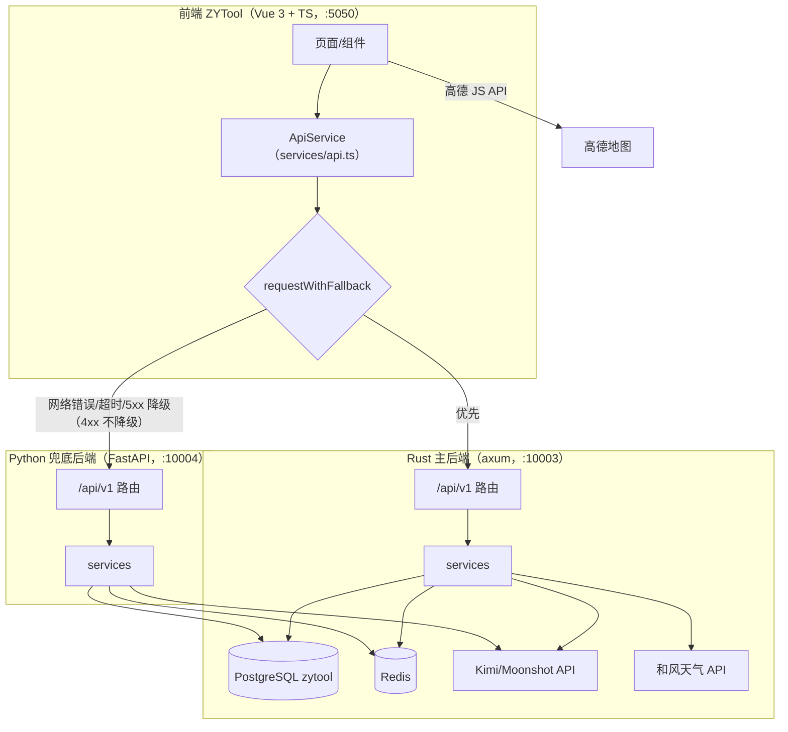

# 01 系统概述

> 本文整合原公共知识库 `01-architecture.md`，2026-11-18 对照 `main.rs`、`api.ts`、`appConfig.ts` 核实。

## 总体架构

前后端分离 + 双后端部分兜底：

- **后端（主要）**：Rust / axum，`Backup/tools_project_rust/`，当前 `http://localhost:10003`（`.env` `PORT=10003`，源码默认 8000）
- **后端（兜底）**：Python 3.9+ / FastAPI，`Backup/tools_project_py/`，当前 `http://localhost:10004`（`.env` `PORT=10004`，源码默认 8000）
- **前端**：Vue 3 + TypeScript + Vite + Ant Design Vue 4.x，`ZYTool/`，开发端口 5050

## 功能域

- **AI Agent 系统**：Kimi（Moonshot）+ SSE 流式对话 + Function Call（天气工具，2026-11-10 起流式/同步均接入）；会话与消息持久化 PostgreSQL，历史走 Redis List 缓存；Python 兜底仅无状态单轮流式 / 同步
- **在线工具集**：ViewFront 浏览器端工具（JSON 格式化 / Base64 / URL 编解码 / 颜色选择器 / 时间戳，纯前端处理）+ ViewBack 服务器端工具（文本对比 / 正则测试 / 密码生成 / 时间戳转换 / 地图路线 mock）
- **MES 系统**：GCPM 规则管理（Mock 数据演示，未接后端）
- **后台管理**：数据库表只读浏览、field_roots 字段字根数据字典、双后端服务状态（要求 JWT + admin 角色）
- **财务小账本**：纯浏览器 localStorage 实现（`zytool-little-ledger-v1`），不调后端

## 双后端机制（前端实现）

`ZYTool/src/services/api.ts` 创建两个 Axios 实例（地址配置见 `src/config/appConfig.ts`）：

- `rustApi`：`VITE_RUST_API_BASE_URL` + `/api/v1`，默认实例
- `pythonApi`：`VITE_PYTHON_API_BASE_URL` + `/api/v1`，兜底实例
- 两个实例超时均为 60s，请求拦截器自动附带 `Authorization` 与 `X-Base-Info` 头，响应拦截器统一打印毫秒级耗时日志

降级规则：

- 普通请求统一走 `requestWithFallback`：优先 Rust；**网络错误 / 超时 / 5xx 自动降级 Python；4xx 不降级**
- 流式聊天 `ApiService.chatStream(message, sessionId?, signal?, modelId?)`：优先 Rust `POST /agents/chat`，失败降级 Python，支持 `AbortSignal` 中止
- 流式实现：Axios `adapter: 'fetch'` + `responseType: 'stream'` 获取 `ReadableStream`，按 SSE（`data: ...`）逐行解析，遇 `[DONE]` 结束
- **Python 只覆盖部分接口且有响应结构差异**，Agents 会话/模型、账号绑定/QQ 登录、DB 健康检查不能依赖降级；逐路由覆盖矩阵见 [09-API契约与路由](09-API契约与路由.md)

## 统一响应结构

- 目标契约：`BaseResponse<T>` 含 `success` / `message` / `base` / `data`
- `BaseInfo` 由前端请求头 `X-Base-Info` 传入（computer_name / ip / username / screen_name）；前端 `unwrapResponse` 只在存在 `success` 和 `data` 时解包，否则返回原始结构
- Rust 普通 JSON handler 按该结构返回；`/agents/chat` 是 SSE 不属于 JSON 响应；`AppError` 的错误响应不透传 `BaseInfo`
- Rust 根路由挂统一 404 兜底，未匹配路径返回 `BaseResponse` 结构的 404
- Python 当前偏差详见 [09-API契约与路由](09-API契约与路由.md)

## 认证

- JWT Bearer Token（算法固定 HS256），前端存 localStorage（`ZYTool/src/utils/auth.ts`）
- Rust 侧 `core/auth.rs` 提供 `CurrentUser` 提取器，用户使用 PostgreSQL；Python 当前使用独立的内存测试用户（重启丢失，不与 Rust 用户库同步）
- 401 响应时前端自动 `clearAuth()` 并跳转 `/?redirect=...`
- `logout` 把 token 的 SHA-256 摘要写 Redis 黑名单（TTL = token 剩余有效期），`CurrentUser` 提取器命中即 401

## 数据库

- PostgreSQL（`zytool` 库，可选）：表结构与初始化前置条件见 [10-数据库设计](10-数据库设计.md)
- Rust 连接池只在启动时初始化一次，失败后打印警告并以无 DB 模式运行；DB 恢复后通常仍需重启进程；此模式下 Agent 和多数认证接口返回 500，DB 无关工具仍可使用
- Python 自 2026-11-06 起有 asyncpg 懒加载连接池（`app/core/db.py`），仅供 admin 后台管理接口使用；DB 未配置时 admin 接口返回 500「数据库连接池未初始化」；懒加载模式下 DB 恢复后无需重启

## Redis

- 2026-11-10 起项目新增 Redis 服务（连接配置登记在 `Config/database.env`，无密码，详见 [04-环境配置](04-环境配置.md)）
- 双端客户端已接入：Rust `core/redis.rs` 启动时初始化多路复用连接（`redis` crate，`get_connection()` 取用，另有 `cache_get / cache_set / cache_del / incr_with_ttl / rate_limit_hit` 通用助手）；Python `app/core/redis_client.py` 懒加载（`redis.asyncio`，`get_redis()` 取用）
- 降级约定与 DB 一致：两端 `REDIS_HOST` 留空或连接失败均以无 Redis 模式继续运行；所有消费点静默降级（缓存未命中回源、限流放行、黑名单不校验）
- **Rust 已消费场景**（Python 兜底端不校验 / 不共享）：
  - 登录防爆破：`login:fail:{用户名}` 计数，默认 5 次失败锁定 600s（`LOGIN_MAX_FAILURES` / `LOGIN_LOCKOUT_SECONDS`），锁定期间 401
  - JWT 注销黑名单：`auth:blacklist:{sha256(token)}`，TTL = token 剩余有效期
  - 工具分类缓存：`tools:categories`，TTL 300s，只缓存读库结果
  - 聊天限流：`rl:chat:{user_id}:{分钟桶}`，默认 20 次/分钟（`CHAT_RATE_LIMIT_PER_MINUTE`），超限 429
  - 公开工具限流：`rl:tools:{IP}:{分钟桶}`，默认 60 次/分钟（`TOOLS_RATE_LIMIT_PER_MINUTE`），中间件挂在 `/tools` 路由，超限 429
  - Agents 会话历史缓存：`agents:history:{session_id}` Redis List，RPUSH 增量追加 + LTRIM 保留 50 条，TTL 1800s，未命中回源 DB 并回填
- **Python 已消费场景**：天气工具缓存（同步客户端，`weather:now:{城市}` 600s、`weather:city:{城市}` 86400s；与 Rust Function Call 天气工具共用 key，双端互享）

## API 入口

`/health`（根健康检查）+ `/api/v1` 下按模块 nest：`agents` / `auth` / `health` / `protected` / `tools`（Rust 另有 `admin` 路由组）。完整方法、认证要求与双端覆盖见 [09-API契约与路由](09-API契约与路由.md)。
