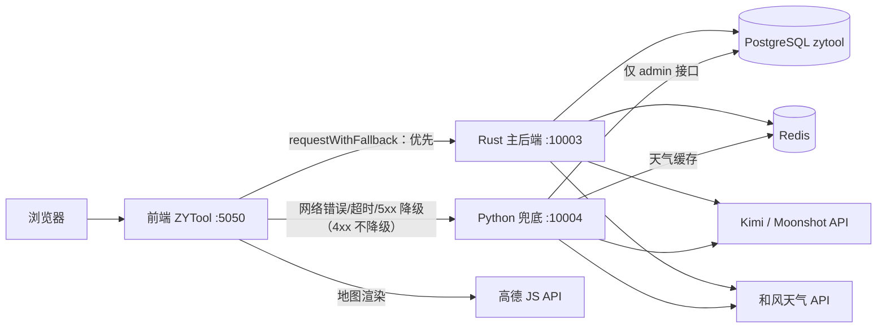

# ZYTool 项目地图（Project Map）

> 生成时间：2026-11-19
> 核对方式：读取仓库实际文件（入口、路由、配置、目录清单、`修改履历.md`、Git 记录），并与 `.qoder/wiki/` 全部文档交叉比对。
> 范围：`/Users/zhaozuyi/Other/100_Code`。本文不含任何密钥或连接串内容。

---

## 0. 一页速览

| 组成 | 路径 | 技术栈 | 端口 | 角色 |
|---|---|---|---|---|
| 前端 | `ZYTool/` | Vue 3.5 + TS 5.9 + Vite 7 + Ant Design Vue 4.2 | 5050 | 唯一 UI；所有后端请求经 `services/api.ts` |
| Rust 主后端 | `Backup/tools_project_rust/` | Rust edition 2024 / axum 0.8 / sqlx / redis | 10003（源码默认 8000） | 主后端，承载几乎全部业务 |
| Python 兜底后端 | `Backup/tools_project_py/` | Python 3.9+ / FastAPI 0.108 / asyncpg | 10004（源码默认 8000） | 部分接口兜底，非等价实现 |
| 项目级连接配置 | `Config/database.env` | env 文本 | — | 供外部工具读取，三端代码不加载 |
| SQL 脚本 | `ToolsAI/` | PostgreSQL DDL | — | 建表源文件，需手工执行 |
| 知识库 | `.qoder/wiki/` | Markdown（Repo Wiki） | — | 2026-11-18 重建的权威文档 |
| 变更记录 | `修改履历.md` | Markdown 表格 | — | 按次记录代码/知识库变更 |

调用与兜底关系：



一句话理解：**前端只认 `ApiService`；Rust 是事实上的唯一完整后端；Python 只保证工具类、认证基础、健康检查、admin 这几类接口在 Rust 挂掉时还能用，Agents 会话/模型与账号绑定没有兜底。**

---

## 1. 仓库顶层结构

```
100_Code/
├── AGENTS.md                 # 工作区规则：默认读 .qoder/wiki、改代码后写修改履历
├── README.md                 # ⚠️ 早期单后端说明，已严重过时（见第 7 节）
├── SKILLS.md                 # ⚠️ 早期技能配置，路径与端口均已失效（见第 7 节）
├── 修改履历.md                # 变更台账（时间/需求/模块/内容/备注）
├── .qoder/wiki/              # 权威知识库（12 篇主文档 + 动画规范 11 篇）
├── Backup/
│   ├── tools_project_rust/   # Rust 主后端（目录名保留历史含义）
│   └── tools_project_py/     # Python 兜底后端
├── Config/
│   └── database.env          # 项目级 DB/Redis 连接（git 忽略，禁止外传）
├── ToolsAI/                  # SQL：zytool.sql（权威全量）+ 两个早期分域脚本
├── ZYTool/                   # 前端工程
└── 2026-11-19/               # 本次梳理产物（不在运行链路中）
```

> `Backup/` 不是备份目录，而是历史命名。实际运行的两个后端都在里面。
> `ZYTool/dist/`、`node_modules/`、`tools_project_rust/target/` 均为构建产物，不参与源码理解。

---

## 2. Rust 主后端（`Backup/tools_project_rust/`）

### 2.1 启动链路

```
start.sh（可选看门狗）
  └── target/debug/tools_project_rust
        └── src/main.rs
              ├── tracing 日志初始化（RUST_LOG 或 SETTINGS.log_level）
              ├── 子命令分支：cargo run -- encrypt-key "<明文>"
              ├── init_pool()         # sqlx 连接池；失败仅告警，进入「无 DB 模式」
              ├── warn_plaintext_api_keys()  # 检测 ai_models 中的明文 Key
              ├── init_user_cache()   # 用户内存缓存（登录查询兜底）
              ├── init_redis()        # 失败仅告警，进入「无 Redis 模式」
              ├── create_app()
              │     ├── GET /health
              │     ├── nest /api/v1  → routes::api_router()
              │     ├── base_info_middleware（解析 X-Base-Info）
              │     ├── request_logging_middleware
              │     ├── CorsLayer（清单 + 本机/私网 predicate）
              │     ├── TraceLayer
              │     └── fallback 404（统一 BaseResponse）
              └── axum::serve(listen(SETTINGS.host:SETTINGS.port))
```

注意：
- `start.sh` 只跑 **debug 二进制**，且**只有二进制不存在时才 `cargo build`**；改完源码必须手动 build。
- DB / Redis 都是「失败降级、不退出」；DB 恢复后通常要重启进程。
- 端口来自 `.env` 的 `PORT`（当前 10003），源码默认 8000。

### 2.2 分层与目录

```
src/
├── main.rs                 # 入口 + 根路由 + CORS/404 + 启动检查
├── core/                   # 横切基础设施
│   ├── config.rs           # Settings + SETTINGS（once_cell + envy + dotenvy）
│   ├── db.rs               # sqlx 连接池（init_pool/get_pool/ping）
│   ├── redis.rs            # 多路复用连接 + cache_get/set/del、incr_with_ttl、rate_limit_hit
│   ├── auth.rs             # JWT 签发/校验、CurrentUser 提取器、黑名单校验
│   ├── crypto.rs           # AES-256-GCM（密钥 = SHA-256(SECRET_KEY)），格式 v1:base64
│   ├── error.rs            # AppError → 统一 BaseResponse
│   ├── middleware.rs       # BaseInfo、请求日志、工具限流
│   └── dbclient/           # C++ BM2::Data::DbClient 的 Rust 移植（预留未接线）
├── models/                 # serde 请求/响应模型，按域分文件
│   ├── base.rs             # BaseResponse / BaseInfo
│   ├── agents.rs auth.rs admin.rs ...
│   └── ei.rs               # EI 平台 EiInfo 结构（预留未接线）
├── routes/                 # HTTP 适配层（薄）
│   ├── mod.rs              # /api/v1 下 nest 六个路由组
│   ├── auth.rs             # 登录/注册/绑定/QQ（约 836 行，最重）
│   ├── admin.rs            # 表浏览 / 字根 / 服务状态
│   ├── agents/             # sessions.rs（会话/模型）、chat.rs（SSE/同步）
│   ├── tools/              # 按工具分文件 + 统一 IP 限流层
│   ├── health.rs           # /health/、/info、/db
│   └── protected.rs        # 受保护示例
└── services/               # 业务逻辑（厚）
    ├── admin.rs            # 表元数据、field_roots 扫描/差异/同步
    ├── agents/             # store.rs（DB 持久化）、llm.rs（模型客户端 + Function Call）、tools.rs（天气）
    └── tools/              # map/password/regex/text/timestamp
```

分层约定：**routes 只做参数/认证/响应组装，业务在 services，数据结构在 models，横切能力在 core。**

### 2.3 路由组一览

| 前缀 | 文件 | 主要内容 |
|---|---|---|
| `/api/v1/auth` | `routes/auth.rs` | login / register / me / logout / bindings / bind(phone,qq,wechat) / qq/auth-url / qq/login |
| `/api/v1/agents` | `routes/agents/` | sessions CRUD、models、chat(SSE)、chat/sync |
| `/api/v1/admin` | `routes/admin.rs` | tables、columns、rows、roots（含 scan/sync）、services |
| `/api/v1/tools` | `routes/tools/` | categories、system-info、text/process、text/compare、regex/test、password/generate、timestamp/convert、map/route、map/route/test |
| `/api/v1/health` | `routes/health.rs` | `/`、`/info`、`/db` |
| `/api/v1/protected` | `routes/protected.rs` | data（JWT）、admin（admin 角色） |

### 2.4 Rust 侧关键现状（影响判断）

- **认证**：登录只按 `users.nickname` 查（字段名叫 `username`）；注册不保存 `email`；JWT 固定 HS256；用户有内存缓存，直接改库不一定即时生效。
- **Agents**：显式 `model_id` 优先（允许选停用模型）；否则取 `is_enabled=true` + priority 最高（60s 缓存）；再回退 `.env` 的 `KIMI_*`。上下文取最近 20 条；系统提示词是代码常量，`ai_sessions.system_prompt` / `ai_prompt_templates` 未接线。
- **Function Call**：仅天气工具；流式端内部两轮请求，对前端透明。
- **Redis 消费**：登录防爆破、JWT 黑名单、`tools:categories` 缓存、聊天限流、工具 IP 限流、会话历史 List 缓存。
- **数据删除**：删除会话先写 `ai_session_archives` 快照，再物理删除（CASCADE）。
- **扩展预留**：`core/dbclient/`、`models/ei.rs` 均未接入路由，带 `#[allow(dead_code)]`。

---

## 3. Python 兜底后端（`Backup/tools_project_py/`）

### 3.1 启动链路

```
run.py
  └── app/main.py
        ├── setup_logging()（最先执行）
        ├── FastAPI(title/version/debug)
        ├── 全局异常处理器（AppException / HTTPException / Exception）
        ├── CORSMiddleware（清单 + cors_origin_regex 私网放行 + credentials）
        ├── RequestLoggingMiddleware
        ├── include_router(api/v1, prefix="/api/v1")
        ├── GET /health（根）
        └── uvicorn.run(host, port)   # 端口取 .env PORT=10004
```

### 3.2 目录

```
run.py                     # 启动入口（uvicorn）
app/
├── main.py                # 应用装配
├── core/                  # config.py、auth.py、security.py、db.py、redis_client.py、
│                          # exceptions.py、middleware.py、logging_config.py
├── api/v1/
│   ├── __init__.py        # 仅转发 endpoints 聚合路由
│   └── endpoints/
│       ├── __init__.py    # /tools 子路由 + admin/agents/auth/health/protected 挂载
│       ├── admin_router.py
│       ├── agents_router.py
│       ├── auth_router.py
│       ├── health_router.py
│       ├── misc_router.py / text_router.py / regex_router.py
│       ├── password_router.py / timestamp_router.py / map_router.py
│       └── protected_router.py
├── schemas/               # base.py（仅 success/message）+ request/ + response/
├── services/
│   ├── admin_service.py   # 表浏览/字根/服务状态（唯一使用 asyncpg 的域）
│   ├── Agents/            # deepseek_client.py、generate.py、tools/（calculate/search/time/weather）
│   ├── MCP/               # 实验代码，未挂 HTTP
│   └── Tools/             # password/regex/text/timestamp_service.py
└── utils/text_utils.py
```

### 3.3 兼容边界（必须知道）

- **认证是假用户库**：`auth_router.py` 内 `fake_users_db`，重启即丢失，与 Rust 的 `users` 表完全无关。admin 接口则用同一 `SECRET_KEY` 校验 JWT 并检查 `roles` 含 `admin`。
- **Agents 无状态**：`/agents/chat` 不读 JWT、不查库、无历史、无 Function Call；`/agents/chat/sync` 才带工具。没有 sessions/models 路由。
- **数据库**：`core/db.py` 懒加载 asyncpg 池，**只服务 admin 接口**；`DATABASE_URL` 为空则 admin 返回 500。
- **Redis**：懒加载，当前只有天气工具缓存（与 Rust 共用 `weather:*` key）。
- **响应结构**：多数接口直接返回业务字段，不套 `data`；`BaseResponse` 只有 `success/message`；不解析 `X-Base-Info`。
- **MCP**：未挂载，属于实验代码。

---

## 4. 前端（`ZYTool/`）

### 4.1 启动与骨架

```
index.html → src/main.ts（全量注册 Ant Design Vue + reset.css）
           → App.vue（顶栏/主题 provide/路由出口）
           → router/index.ts
```

路由采用 **元数据表 + `import.meta.glob` 动态注册**：

```
routeDefs[]（path/name/view|component/redirect/requiresAuth）
  → 循环 addRoute()
  → view 指向 views/ 相对路径，懒加载
  → beforeEach 检查 meta.requiresAuth
```

| 路径 | 页面 | 认证 |
|---|---|---|
| `/` | 登录/注册/QQ 回调 | 否 |
| `/home`、`/tools`、`/settings` | 首页、工具中心、设置 | 否 |
| `/tools/json|base64|url|color|timestamp` | ViewFront 五工具（纯浏览器） | 否 |
| `/tools/diff` | 文本对比（调后端） | 否 |
| `/tools/sql` | SQL 合理性静态检查（纯前端） | 否 |
| `/tools/map` | 高德路线规划（调后端 mock） | 否 |
| `/agents/chat` | AI 助手 | 否 |
| `/finance/ledger` | 小账本（localStorage） | 否 |
| `/mes/gcpm-rule` | GCPM Mock 演示 | 否 |
| `/admin`（`/admin/database` 重定向） | 后台管理 | 是 |
| `/:pathMatch(.*)*` | → `/` | — |

### 4.2 目录

```
src/
├── views/
│   ├── Agents/ChatView.vue/.ts/.css
│   ├── ViewFront/（JSON/Base64/URL/Color/Timestamp）
│   ├── ViewBack/（Diff/SqlRationality/RouteMap；MapLocationView 未挂载）
│   ├── MES/GCPMRuleView.*
│   ├── Finance/LedgerView.*
│   ├── Admin/（AdminView 外壳 + Database/Roots/Services 三面板）
│   └── HomeView / ToolView / LoginView / SettingsView
├── services/
│   ├── api.ts              # 唯一后端出口：rustApi/pythonApi + requestWithFallback + chatStream
│   └── frontendTools.ts    # 纯前端 JSON/Base64/URL/颜色转换
├── config/appConfig.ts     # 地址按 hostname 自适应 :10003/:10004，可被 VITE_* 覆盖
├── router/index.ts
├── styles/                 # variables → base → components → formStyles → toolStyles → utilities
│   └── gridView/           # 统一表格复用件（GridView.vue + css + index.ts）
├── utils/                  # auth.ts、startVoiceInput.ts、formHelper.ts、ei/
└── Mock/                   # ChatData / GCPMRuleData / SqlRation
```

### 4.3 服务层行为（最重要）

- 两个 Axios 实例：`rustApi`（默认）、`pythonApi`（兜底），超时均 60s。
- 请求拦截器自动带 `Authorization` 与 `X-Base-Info`；响应拦截器打印耗时；401 清登录态并跳 `/?redirect=...`。
- `requestWithFallback`：**无响应/超时/5xx → 降级 Python；4xx 原样抛出**。
- `chatStream`：`adapter: 'fetch'` + `responseType: 'stream'`，逐行解析 `data:`，`[DONE]` 结束，支持 `AbortSignal`。
- 工具中心数据来自 `/tools/categories`（读 `tool_categories`/`tools` 表），跳转优先用后端 `route`，缺失才按工具 ID 回退映射；前端另合并本地「财务工具」分类（ID 4）与小账本（ID 16），并对地图 ID 13/15 做去重修正。

---

## 5. `Config` 与 `ToolsAI`

### 5.1 `Config/database.env`

- 项目级连接配置，**三端代码都不加载**；供外部工具（如 Java + JDBC 校验）读取。
- 含 Oracle/PostgreSQL 分项与 Redis 连接；已在 `.gitignore` 中单独忽略。
- 仅记录位置与用途，禁止把内容复制到文档或回答。

### 5.2 `ToolsAI/`

| 文件 | 状态 | 说明 |
|---|---|---|
| `zytool.sql` | **权威** | 全量 14 张表（认证 4 + AI 7 + 后台 1 + 工具 2），末尾含 `field_roots` 与 `tool_categories/tools` |
| `ai_assistant_schema.sql` | 早期分域脚本 | 只含 6 张 AI 表，无 `ai_session_archives`；`CREATE TABLE IF NOT EXISTS` |
| `user_login_schema.sql` | 早期分域脚本 | 只含 4 张认证表；`CREATE TABLE IF NOT EXISTS` |

注意：
- Rust **不做 migration**，建表/改表必须手工执行。
- `zytool.sql` 不是一键脚本：使用了 `set_updated_at()` 但未定义该函数；`gen_random_uuid()` 依赖 PG 版本/扩展。
- `zytool.sql` 中的 `CREATE TABLE` 没有 `IF NOT EXISTS`，在已有库上重复执行会报错。

---

## 6. 三端调用与兜底关系

### 6.1 谁调用谁

| 调用方 | 被调用方 | 说明 |
|---|---|---|
| 前端 | Rust `/api/v1/*` | 默认路径，所有业务 |
| 前端 | Python `/api/v1/*` | 仅降级时；路径相同但能力子集 |
| 前端 | 高德 JS API | 地图渲染/定位（Key 在 `appConfig.ts`） |
| Rust | PostgreSQL | 用户、AI 会话/消息、admin、工具分类 |
| Rust | Redis | 限流、黑名单、缓存、会话历史 |
| Rust | Kimi / 和风天气 | LLM 与天气工具 |
| Rust | QQ 互联 | OAuth 授权/换取 token |
| Python | PostgreSQL | **仅 admin 接口**（asyncpg 懒加载） |
| Python | Redis | 天气缓存 |
| Python | Kimi / 和风天气 | 单轮对话与天气工具 |

### 6.2 降级覆盖矩阵（按能力）

| 能力 | Rust | Python 兜底 | 降级后果 |
|---|---|---|---|
| 健康检查 | 完整（含 `/db`） | 仅 `/health`、`/health/info` | `/health/db` 降级后 404 |
| 登录/注册/me/logout | 完整（DB + Redis） | 内存假用户 | 能登录但与 Rust 用户体系不互通 |
| 账号绑定 / QQ 登录 | 完整 | **缺失** | 降级后 404 |
| Agents 会话/模型 | 完整 | **缺失** | 降级后 404 |
| Agents 聊天 | SSE + 工具 + 持久化 | 无状态单轮 | 能用但丢历史、无工具（流式） |
| admin 全部接口 | 完整 | 已对齐 | 可用；`/services` 返回 Python 自身身份 |
| 工具（文本/正则/密码/时间戳/地图） | 完整 | 已实现（部分 mock 行为） | 基本可用 |
| SQL 合理性检查 | 无后端 | 无后端 | 纯前端本地执行 |

### 6.3 双端状态不一致点

- 用户体系：Rust 用 `users` 表；Python 用进程内字典。
- 会话历史：仅 Rust 有 `ai_sessions/ai_messages` 与 Redis List 缓存。
- 限流/黑名单：仅 Rust 生效，Python 不校验。
- 响应包装：Rust 统一 `BaseResponse`；Python 多数裸返回，前端靠 `unwrapResponse` 兼容。

---

## 7. 知识库评估（`.qoder/wiki/`）

### 7.1 文档清单

| 文档 | 主题 | 覆盖范围 | 与代码一致性 |
|---|---|---|---|
| `README.md` | 入口/模块地图/路由规则 | 项目简介、端口、文档导航 | 高 |
| `01-系统概述.md` | 总体架构 | 双后端、降级、统一响应、认证、DB、Redis 七场景 | 高 |
| `02-技术栈.md` | 技术栈 | 三端依赖版本、基础设施、外部服务 | 高（版本与 manifest 一致） |
| `03-快速入门.md` | 启动/验证 | 环境要求、三端命令、验证、常见问题 | 高 |
| `04-环境配置.md` | 环境变量 | 三端变量、`Config/database.env`、敏感文件位置 | 较高（少量需补充，见 7.2） |
| `05-开发规范.md` | 开发流程 | 新增工具/Agent/接口步骤、代码风格、提交前检查 | 高 |
| `06-前端架构.md` | 前端 | 目录、路由、服务层、主题样式、各页面功能点 | 高（非常细） |
| `07-后端架构-Rust.md` | Rust | 目录、约定、认证现状、Agents、DbClient 移植 | 高 |
| `08-后端架构-Python.md` | Python | 定位、目录、配置、兼容边界 | 较高（CORS 描述偏旧，见 7.2） |
| `09-API契约与路由.md` | 契约 | 响应/SSE/CORS/认证 + 完整路由覆盖矩阵 | 高（同上 CORS 小偏差） |
| `10-数据库设计.md` | 数据库 | 14 张表、field_roots 数据字典、初始化前置条件 | 高 |
| `11-UI动画设计规范/` | 动画规范 | 摘要 + `ui-animation-skills/` 完整 11 篇 | 高（与 06 一致） |

整体结论：**这套 Wiki 质量明显高于常见项目文档**，端口、目录、路由、降级规则、Redis key、表结构都能与代码对上，且标注了大量「已建库未接线」「预留未接线」的真实边界。主要问题集中在 Wiki 之外的旧文档，以及两处未及时更新/未覆盖的细节。

### 7.2 明显过时、缺失或与代码不符之处

按影响排序：

1. **根 `README.md` 严重过时（影响最大）**
   - 仍描述「后端使用 Python FastAPI」单一后端，未提 Rust 主后端；
   - 技术栈写 DeepSeek/LangChain/SQLAlchemy，实际主链路是 Kimi + axios + sqlx/asyncpg；
   - 项目结构画的是 `Backup/app/`、`Backup/run.py`，实际路径是 `Backup/tools_project_py/app/`；
   - 端口写 8000，实际 10003/10004/5050；
   - 把 SQL 合理性检查列为「后端工具」，实际是前端本地静态检查。
   - 建议：要么重写，要么在开头加「历史文档，以 `.qoder/wiki/` 为准」的醒目声明。

2. **根 `SKILLS.md` 完全失效**
   - 指向 `api/v1/agents/router.py`、`services/public/deepseek_client.py`、`services/public/tools/__init__.py` 等**仓库中不存在**的路径；
   - 端口仍写 8000。
   - 建议：删除或改为指向 `.qoder/wiki/07/08`。

3. **Wiki 08/09 对 Python CORS 的描述偏旧**
   - 文档称「Python 只放行 `127.0.0.1` 而非整个 `127.*`」，容易被读成「只放行本机」；
   - 实际 `app/core/config.py` 已有 `cors_origin_regex`，覆盖 `localhost`、`127.0.0.1`、`*.local`、`192.168.*`、`10.*`、`172.16-31.*`，`main.py` 也已传入 `allow_origin_regex`。
   - 当前真实差异只剩：仅 `127.0.0.1`（不是整个 `127.*`）+ Python 开启 credentials。

4. **Wiki 10 未说明 `ToolsAI/` 里的两个早期 SQL 脚本**
   - 文档只把 `zytool.sql` 当 DDL 源文件；
   - 实际还有 `ai_assistant_schema.sql`、`user_login_schema.sql`，结构是 `zytool.sql` 的子集且缺少 `ai_session_archives`、`field_roots`、`tool_categories/tools`；
   - 新人若先执行旧脚本，会得到不完整 schema。

5. **Wiki 04 未标注 Python `.env.development` 中的遗留变量**
   - 该文件除 `KIMI_*` / `DEEPSEEK_API_KEY` / `QWEATHER_*` 外，还有 `DB2_*`、`ORA_*` 两组连接项；
   - 代码中**没有任何引用**（`grep DB2_/ORA_` 无结果），属于历史遗留；
   - 文档未说明「可忽略」，容易让人以为项目仍支持 DB2/Oracle。

6. **Wiki 04 的 Rust 变量表与实际 `.env` 有轻微落差（非错误，但需注意）**
   - 文档列出 `SECRET_KEY`、`LOG_LEVEL` 等；
   - 当前 `Backup/tools_project_rust/.env` 实际未设置这两项，走的是 `config.rs` 内的开发默认值（`SECRET_KEY` 默认值同时用于 JWT 签名与 API Key 加密密钥派生）；
   - 生产部署必须显式覆盖，文档虽已提醒，但容易被「表里有」误读为「已配置」。

7. **Wiki 10 的「当前数据库核验」段落是历史快照**
   - 「11 张业务表」是 2026-10-27 的状态；
   - 当前表总览已是 14 张（新增 `ai_session_archives`、`field_roots`、`tool_categories`、`tools`，同时 `input_roots` 已删除）；
   - 正文表清单是最新的，但快照段落按日期读即可，不要当作当前数量。

8. **`修改履历.md` 与 Wiki 的同步关系**
   - 履历最后一条（2026-11-18）记录了 Wiki 重构，且明确提到「Qoder IDE 内置 Wiki 仍是旧快照」；
   - 这意味着：**IDE 里自动生成的 Wiki 不能当权威**，要以 `.qoder/wiki/` 文件为准。

### 7.3 没有明显问题的部分

- 端口（10003/10004/5050）、目录地图、路由清单、降级条件（4xx 不降级）、Redis 七场景、`field_roots` 的扫描/差异/同步语义、前端路由表与 `requiresAuth`、`yarn`/`start` 拼写问题、`start.sh` 看门狗行为，均与代码一致。
- `06-前端架构.md` 细节非常多（样式 token、后台表格、账本、聊天侧栏），抽查均能对上。

---

## 8. 「想改某类东西，去看哪里」对照表

### 8.1 按改动类型

| 我想改… | 先看文档 | 主要代码文件 |
|---|---|---|
| 新增/修改 Rust 接口 | `05`、`09` | `src/routes/<域>.rs`（或 `routes/agents/`、`routes/tools/`）+ `src/services/` + `src/models/` |
| 新增 Rust 工具 | `05`、`09` 工具段 | `src/services/tools/` → `src/routes/tools/` → `models/` |
| 改 LLM 模型选择/提示词/工具调用 | `07` Agents 段 | `src/services/agents/llm.rs`、`tools.rs`、`store.rs`、`routes/agents/chat.rs` |
| 改登录/注册/JWT/绑定 | `01` 认证、`07` 认证现状 | `src/routes/auth.rs`、`src/core/auth.rs`、`src/core/crypto.rs` |
| 加 Redis 缓存/限流 | `01` Redis 段 | `src/core/redis.rs` + 消费点（`middleware.rs`、`routes/*`） |
| 改后台管理（表/字根/服务） | `09` 后台管理、`10` field_roots | `src/routes/admin.rs`、`src/services/admin.rs`、`src/models/admin.rs` |
| 改表结构 / 加字段 | `10` | `ToolsAI/zytool.sql`（手工执行）+ 对应 `models`/`services` SQL |
| 改 Python 兜底接口 | `08`、`09` 矩阵 | `app/api/v1/endpoints/*_router.py` + `app/services/` + `app/schemas/` |
| 改 Python 配置/密钥加载 | `04`、`08` | `app/core/config.py`、`app/services/Agents/deepseek_client.py` |
| 改前端页面 | `06` 对应功能段 | `src/views/<域>/XxxView.vue/.ts/.css` |
| 加前端路由 | `06` 路由段、`05` | `src/router/index.ts` 的 `routeDefs` 加一行 |
| 加/改后端调用 | `06` 服务层、`09` | `src/services/api.ts` 的 `ApiService` |
| 改双后端地址/降级 | `01`、`04` | `src/services/api.ts`、`src/config/appConfig.ts` |
| 改主题/样式/动效 | `06` 主题与样式、`11` | `src/styles/variables.css` 等；动效 token 必用全局变量 |
| 改工具中心分类/跳转 | `06`、`10` 工具域 | `tool_categories`/`tools` 表 + `views/ToolView.vue` |
| 改小账本 | `06` 财务段 | `src/views/Finance/LedgerView.*`（localStorage，无后端） |
| 改 MES/GCPM | `06` MES 段 | `src/views/MES/GCPMRuleView.*`、`src/Mock/GCPMRuleData.ts` |
| 启动/构建/排错 | `03` | `start.sh`、`run.py`、`package.json` |
| 环境变量 | `04` | 各端 `.env`（禁止提交/外传） |

### 8.2 按「我遇到的现象」

| 现象 | 最可能原因 | 去看 |
|---|---|---|
| Agent/认证接口 500，工具还能用 | Rust 无 DB 模式 | `main.rs` 启动日志、`core/db.rs`、`07` |
| 降级后功能 404 | 该接口 Python 未实现 | `09` 覆盖矩阵 |
| 登录后过一会 401 | token 过期 / 被加入黑名单 | `04`、`core/auth.rs`、`core/redis.rs` |
| 改了 Rust 代码没生效 | `start.sh` 不自动重编译 | `03`、`start.sh` |
| 天气工具 403 Invalid Host | 和风新控制台需专属 Host | `04`、`07` 工具与运行边界 |
| 工具分类改了不生效 | Redis 缓存 300s | `01` Redis 段、`services/tools/misc.rs` |
| 前端跨域失败 | CORS 清单/私网规则 | `01`、`09` CORS、`main.rs`、`app/core/config.py` |
| 后台 403 | 非 admin 角色 | `routes/admin.rs`、`admin_router.py`、`06` 后台管理 |
| 工具页显示「开发中」 | `route` 为空且 ID 未映射 | `tools` 表、`ToolView.vue` 两张 RouteMap |

---

## 9. 快速自检命令

```bash
# 后端存活
curl http://localhost:10003/health
curl http://localhost:10004/api/v1/health

# Rust 类型检查 / 构建
cd Backup/tools_project_rust && cargo check

# 前端类型检查 + 构建（唯一 typecheck 入口）
cd ZYTool && yarn build

# 端口占用排查
lsof -i :10003 -i :10004 -i :5050
```

---

## 10. 结论

- 项目是「**一个 Vue 前端 + Rust 主后端 + Python 部分兜底**」的双后端结构，不是仓库根 README 描述的「Python 单后端」。
- 真正的权威说明在 `.qoder/wiki/`；根 `README.md`、`SKILLS.md` 属于历史残留，应按过时文档处理。
- 知识库与代码整体一致性高，最值得修的三处是：**根 README/SKILLS、Python CORS 描述、`ToolsAI` 旧 SQL 脚本说明**。
- 改代码前按第 8 节定位；改完后按 `AGENTS.md` 更新 `.qoder/wiki/` 对应文档并追加 `修改履历.md`。
